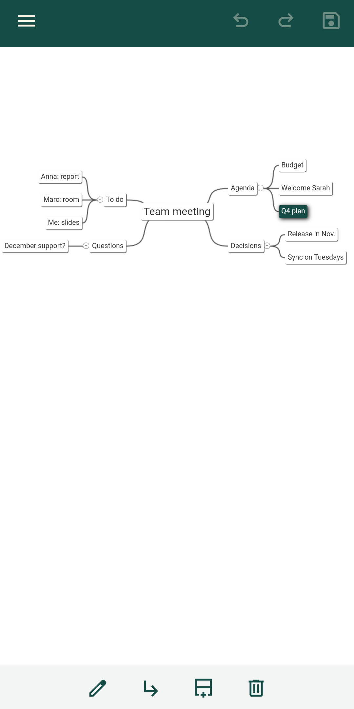
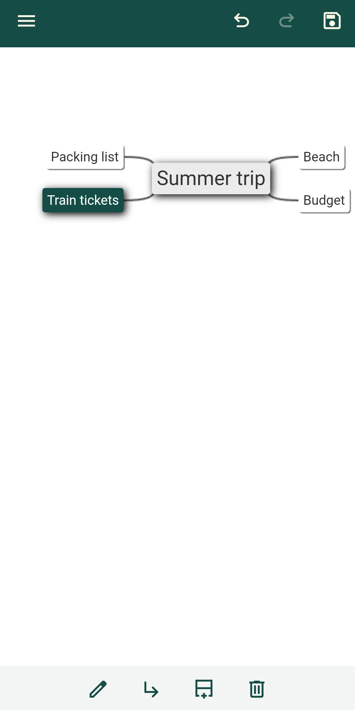
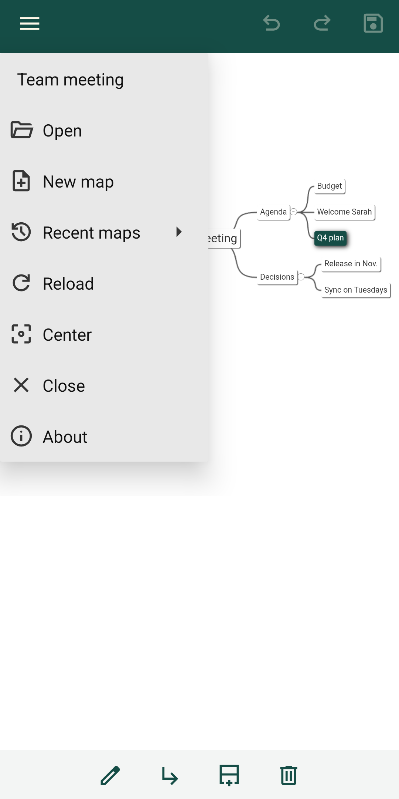

# Mapling

Your Freeplane mind maps on your Android phone or tablet. Open a map (`.mm` file) from Google Drive or any storage, read it, make quick changes anywhere (in the bus before a meeting, away from your computer), and save it back without losing anything Freeplane wrote. Or start a new map in a few taps, and finish it later in Freeplane.

<p>



</p>

## What it does

- Open a map from Google Drive, the phone's storage or any document provider.
- **Create a simple map in seconds**: New map, then add branches one tap at a time. It is an ordinary Freeplane map, ready to be enriched in Freeplane.
- Edit the text of a node, add, delete and move nodes; undo and redo. Zoom with two fingers, move the selected node by holding it, fold and unfold branches.
- Only what you edit changes: notes, icons, styles, links and everything else Freeplane wrote are kept exactly as they were. Mapling tells you when a map holds content it does not display, and asks before deleting a branch that holds some.
- Unsaved changes are kept as a draft, even if Android closes the app.
- Before saving, Mapling checks that the map was not changed elsewhere (on your computer, for instance); if it was, you can save a copy and keep both versions.
- Recent maps in one gesture; the map you left open is opened again.
- English and French.

Supported format: maps written by Freeplane 1.12. Older (FreeMind included) and newer formats open read-only.

## Install

- **Google Play**: coming soon (Android 8 or later).
- **APK**: download it from the [releases](https://github.com/mercibe/mapling/releases) page.
- **Build it yourself**: see [android/README.md](android/README.md).

No account, no ads, no tracking, and no network access: the app asks for no permission at all. See the [privacy policy](PRIVACY.md).

## Try it in a browser

```
npm install
npm run build
python3 -m http.server 8765    # or any static file server, from the repository root
```

Then open <http://localhost:8765/web/>, and open a `.mm` file (for instance from `fixtures/`).

- Select a node by clicking it; edit its text by double-clicking it (or F2, or the Edit text button); add, delete, undo and redo with the toolbar; drag a node onto another to move it.
- A small lock marks a text that can only be edited in Freeplane (rich or multi-line text); a small dot marks content that is kept but not shown (notes, icons, links…). Select the node to see what it holds.
- A browser cannot write to the file you opened: *Download a copy* saves the result, and the map counts as saved only once you confirm the copy is where you want it. Until then, unsaved changes are kept as a draft in the browser.

## Principles

- The `.mm` file is the only source of truth: only what you edit changes; notes, icons, styles and everything else are kept as they are.
- No network access, no account, no tracking: the app opens and writes your documents through the system's document picker ([privacy policy](PRIVACY.md)).
- A small core shared by all platforms, with thin native shells around it.

## Documentation

- [Architecture](docs/ARCHITECTURE.md): how the core and its map view work.
- [Bridge contract](docs/BRIDGE.md): everything needed to write a new shell (Android, iOS, web).
- [Android app](android/README.md): building, installing, testing.
- [Contributing](CONTRIBUTING.md): workflow, license of contributions, file headers.

## Development

Requires Node 24 or later.

```
npm install     # dev dependencies only: typescript, @xmldom/xmldom
npm test        # tests: core (round trips on every test map in fixtures/) and web shell drafts
npm run check   # type check
npm run build   # compile the core to core/dist
npm run build:web  # build, then assemble the web shell in web/dist, ready to host anywhere
```

## License

GPL-3.0-or-later, with an additional permission for distribution through app stores: see [LICENSE](LICENSE) and [LICENSE-EXCEPTION.md](LICENSE-EXCEPTION.md).

Uses [jsMind](https://github.com/hizzgdev/jsmind) (BSD-3-Clause). The Android build uses the [Gradle](https://gradle.org) wrapper (`android/gradlew`, `android/gradle/wrapper/`, Apache-2.0). The Android app uses [AndroidX](https://developer.android.com/jetpack/androidx) and [Material Components](https://github.com/material-components/material-components-android) (Apache-2.0), and icons from [Material Symbols](https://github.com/google/material-design-icons) (Apache-2.0, see `android/LICENSE-material-symbols.txt`). Mapling is not affiliated with the Freeplane project.
